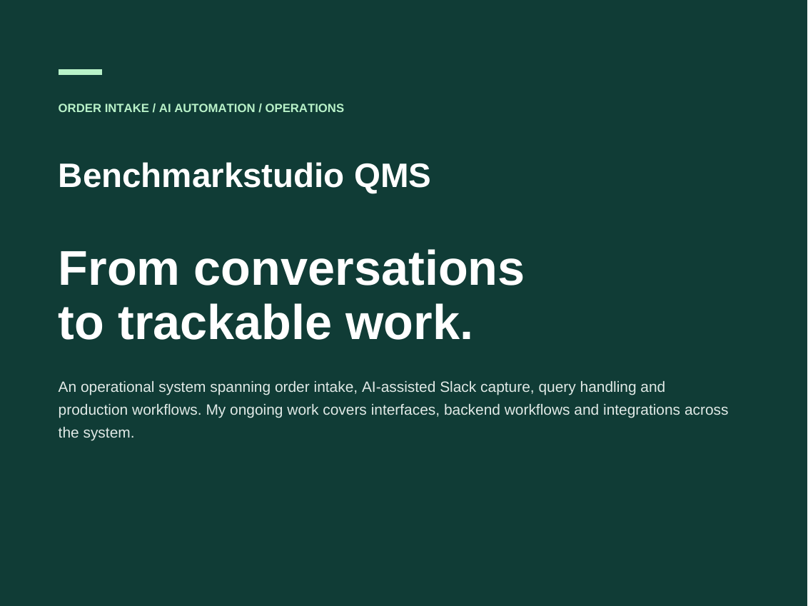
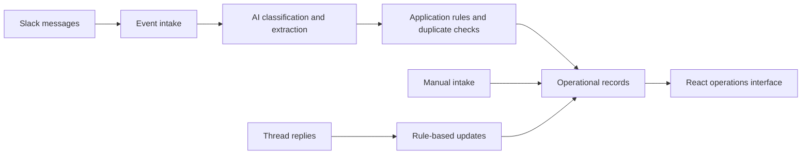

# Benchmarkstudio QMS

## Order intake, AI-assisted capture and operational workflows

A case study of Mohsin Jamil's ongoing work on Benchmarkstudio QMS, within the ilaan sister-company group. My current primary project is BMGenie.ai; QMS is another product I contribute to periodically.

QMS spans order entry, production-role workflows, AI-assisted intake from Slack, query handling and staff visibility. The work includes both an earlier PHP system and a newer React operations interface.

[Read the detailed case study](case-study.md) · [View the illustrated PDF](assets/benchmarkstudio-qms-case-study.pdf)

## What the system covers

- Manual order/query intake, project and department context, and editable records.
- AI-assisted classification of actionable Slack messages and extraction of order information.
- Multiple order references, active-record duplicate checks and thread-linked updates.
- Pending, issue and completed views, deadlines, first replies and status history.
- CSR activity and shifts, reporting and Slack thread visibility.
- Earlier PHP order workflows for assignment, drawing, checking, amendments and final uploads.

## Intake overview

The diagram shows the intake flow and the separate rule-based thread-update path.

## Technology and contribution

React, PHP, MySQL, model API integration and Slack APIs. My work spans application interfaces, backend workflows and integrations. The case study separates the earlier production-role workflows from the newer React operations interface.

## Sharing scope

This repository contains original case-study prose, conceptual workflow diagrams and a portfolio PDF. It excludes production code, exact model prompts, credentials, internal URLs, customer records and performance claims that have not been measured. Brands belong to their respective owners.

The case study is prepared for review. Its diagrams explain implementation workflows.
